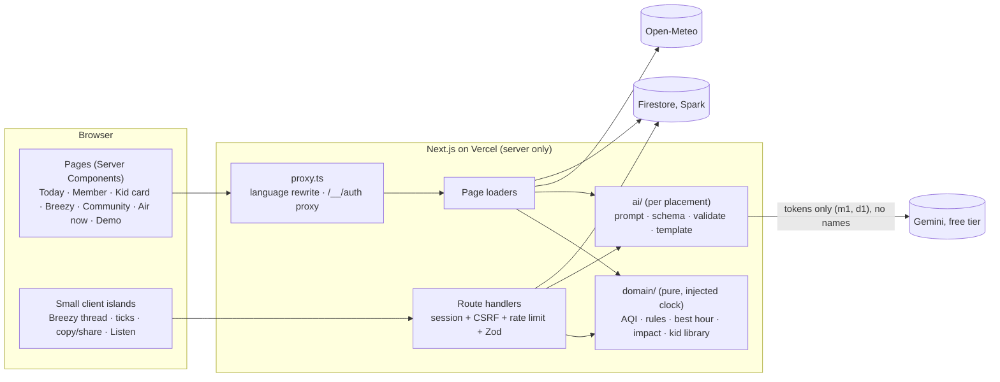

# BreatheWell

A family air coach for winter smog in Indian cities, built for Google PromptWars Challenge 6 (Urban Air Quality Assistant).

> Create a GenAI-powered assistant that helps families and communities navigate severe winter smog and urban air pollution. The application should suggest low-emission daily routines, indoor air quality hacks, and sustainable alternatives tailored to their location and lifestyle, while clearly explaining the direct impact of their choices.

BreatheWell reads the hourly air where a family lives and tells each person, in English or Hindi, whether they can go out today, the best time to go, what to change and what that change does for them and for the air. Fixed, tested rules decide Go / Go with care / Avoid, the best time and every number; Google Gemini only writes the words, and every screen shows the code's answer first.

## Judge's tour (draft, no sign-in needed)

1. **Landing → Air now.** Pick any Indian city (or allow location). The band card, the 24-hour strip, the 5-day outlook, "At home today" (indoor hacks) and "One swap for the air today" with its CO₂ figure.
2. **Demo family** (`/demo`). The Sharma family in Green Park, Delhi, on a recorded smog morning: one row per person with a verdict chip from the rules. Step the clock (6 am · 12 pm · 4 pm) or switch to the Severe day to see the GRAP note and indoor-first plans.
3. **Dadaji's plan → Why?** Do this · Picture it · The numbers. Then **Riya's kid card**: a face in the band colour, one instruction per activity, no numbers, no cigarettes.
4. **Breezy (demo)** (`/demo/ask`). Chips only, so no visitor text ever reaches Gemini. "Plan Dadaji's temple visit" answers with a card whose chip comes from the rules.
5. **Community message** (`/community?place=…`, linked from Air now). One bilingual, WhatsApp-ready text for a housing society: the header and footer from code, the middle from Gemini (or the "Simple message" template), copy and share buttons.
6. **Learn** (`/learn`) and **Privacy** (`/privacy`).

What one account can't show (screenshots to come on 28 Nov): two phones joining by QR, adding Riya and sharing her kid card, Breezy asking "Who do you mean by 'Papa'?" before anything is sent and then adding to Dadaji's checklist with **Send on WhatsApp**, and the large-text Hindi view.

## Brief to feature

| Brief phrase | What BreatheWell does | Where in the code |
|---|---|---|
| GenAI-powered assistant | Gemini writes the family plan, Breezy's answers and cards, and the community message; every reply passes a validator, and the rules re-check every time it names | [`src/ai/plan`](src/ai/plan), [`src/ai/breezy`](src/ai/breezy), [`src/ai/community`](src/ai/community), [`src/ai/shared/validate.ts`](src/ai/shared/validate.ts) |
| helps families | Adult accounts with a join code and QR, a plan per person, children and teens as dependents with a kid card | [`src/server/handlers/join.ts`](src/server/handlers/join.ts), [`src/domain/family`](src/domain/family), [`src/domain/libraries/kid.ts`](src/domain/libraries/kid.ts) |
| and communities | The daily bilingual society message, cached per area per day | [`src/server/community`](src/server/community), [`src/components/community`](src/components/community) |
| navigate | Go / Go with care / Avoid and the best time, from code, before any AI text | [`src/domain/rules`](src/domain/rules), [`src/domain/air/outlook.ts`](src/domain/air/outlook.ts) |
| severe winter smog | Full CPCB scale, Severe-day mode, the winter caution, the recorded smog morning | [`src/domain/rules/severeDay.ts`](src/domain/rules/severeDay.ts), [`src/domain/rules/context.ts`](src/domain/rules/context.ts), [`src/data/recorded`](src/data/recorded) |
| urban air pollution | Hourly PM2.5, PM10, NO₂, O₃, CO, SO₂ from Open-Meteo; our own CPCB AQI | [`src/data/openMeteo`](src/data/openMeteo), [`src/domain/air/aqi.ts`](src/domain/air/aqi.ts) |
| low-emission daily routines | Activities moved to cleaner hours; car and scooter trips switched to metro, bus or carpool | [`src/domain/rules/planActivity.ts`](src/domain/rules/planActivity.ts), [`src/domain/rules/essentialTrip.ts`](src/domain/rules/essentialTrip.ts) |
| indoor air quality hacks | Home tips from the home set-up (purifier, road-facing windows, fuel, incense) | [`src/domain/libraries/tips.ts`](src/domain/libraries/tips.ts) |
| sustainable alternatives | The alternatives library and the Swap card | [`src/domain/libraries/alternatives.ts`](src/domain/libraries/alternatives.ts), [`src/domain/family/swaps.ts`](src/domain/family/swaps.ts) |
| tailored to their location and lifestyle | Place by location or search; each adult's own routine, travel, age group and optional health ticks | [`src/domain/members/profile.ts`](src/domain/members/profile.ts), [`src/components/place`](src/components/place) |
| clearly explaining the direct impact | Do this · Picture it · The numbers; exposure and cigarettes (adults only), CO₂ and PM for the air, a weekly family total | [`src/domain/impact`](src/domain/impact), [`src/components/air/WhyPanel.tsx`](src/components/air/WhyPanel.tsx) |

## Architecture



The rules engine is the guardrail: `domain/` decides every verdict and time, `ai/` only words them, and any Gemini text that fails the validator (numbers, names, cigarettes, medicines, contradictions with the rules) falls back to the template. Public pages never send a visitor's text to Gemini.

| Folder | What lives there |
|---|---|
| `src/domain/` | Pure rules and maths with an injected clock: AQI and bands, the guardrail table, best hour, 5-day outlook, exposure, cigarettes, emissions, facts, tips, alternatives, the kid library, dependent defaults, kin words, Breezy's activity map and card-time check |
| `src/ai/` | One folder per Gemini placement (`plan`, `breezy`, `community`) with its prompt, schema, validator and template, plus `shared/` (the Gemini wrapper and the validator's checks) |
| `src/data/` | Open-Meteo and BigDataCloud clients (Zod-parsed), the recorded demo days and the stored demo answers |
| `src/server/` | Route handlers, page loaders, repositories over Firestore, the air service, quotas and rate limits, CSP |
| `src/view/` | View models (types only) shared by the loaders and the components |
| `src/app/`, `src/components/` | Next.js routes (thin shells) and small presentational components |
| `src/i18n/` | `en.json`, `hi.json` (same keys, tested) and the typed `t()` |

## Setup

Node 22+. With no environment variables the app builds and serves the public pages and the demo.

```bash
npm ci
npm run check              # lint, format, type-check, unit tests with coverage
npm run build
npm run test:e2e           # Playwright + axe against the production build (Open-Meteo stand-in, no network)
npm run test:emulator      # Firestore rules on the emulator (Java 21+)
npm run test:e2e:emulators # signed-in E2E on the Auth and Firestore emulators, with a local Gemini stand-in
```

To run it for real (all free tiers):

1. Create a Firebase project on the Spark plan; enable Google sign-in and Firestore; deploy `firestore.rules` and `firestore.indexes.json`.
2. Create a free Gemini API key in Google AI Studio.
3. Fill in the variables named in `.env.example` (locally in `.env.local`, on Vercel in the project settings; region `bom1` is set in `vercel.json`). Never commit values.
4. Once a key exists, record the demo's stored answers once: `npm run demo:record-plans` and `npm run demo:record-breezy`, review the JSON files in `src/data/demo/`, then run `npm test`.

## Languages

Every page is prerendered twice, under `app/[lang]` (`/en`, `/hi`). `src/proxy.ts` rewrites each request to the variant in the viewer's language (the `bw-lang` cookie, else the browser's language), so Hindi is server-rendered with `<html lang="hi">` and no flash. The text size (`bw-text` cookie: 100 %, 125 %, 150 %) is applied before paint.

## Gemini API terms

The Gemini API Additional Terms (effective 23 Mar 2026, checked 20 Nov 2026) say: "You must be 18 years of age or older to use the APIs." They also rule out services directed towards or likely to be accessed by under-18s. So BreatheWell accounts are for adults only; children and teens are added by a parent as dependents and never use the app or reach Gemini except as anonymous tokens.

## Security notes

- **Per-IP rate limits rely on the host's forwarded-for header.** Air now and `/api/air` allow 60 checks per hour per hashed IP and `/api/community` 20, kept in memory. Breezy allows 5 questions a minute per user, and 30 a day per user and 60 per family (Firestore counters).
- **Breezy's defences:** emergency words get fixed code text and no Gemini call; names and aliases are swapped for tokens before sending; the question (≤ 300 characters) and the client-held history (≤ 800) are cleaned and fenced; Gemini has no tools; every card's person, fact and time is checked again on the server, and the confirmed action is re-validated before anything is written.
- **Content Security Policy without nonces.** The policy (`src/server/csp.ts`) limits every source to this app, Firebase, Google sign-in, Open-Meteo and BigDataCloud, blocks framing and inline event handlers. It allows `'unsafe-inline'` scripts for the Next.js bootstrap because the public pages are static; pages render no user-supplied HTML.
- Other headers: HSTS, `nosniff`, a strict referrer policy, `Permissions-Policy` and `Cross-Origin-Opener-Policy: same-origin-allow-popups`.

## Data

Air: [Open-Meteo Air Quality API](https://open-meteo.com/en/docs/air-quality-api) (CAMS model), shown on India's CPCB scale, calculated from PM2.5 and PM10. Place names: BigDataCloud. Model data can read lower than city stations during smog.

## Contact

Questions about BreatheWell or about your data: open an issue in this repository (the **Issues** tab on GitHub). The Privacy page points here. You can also delete your own data at any time from Profile → Delete my account.

## Licence

MIT
