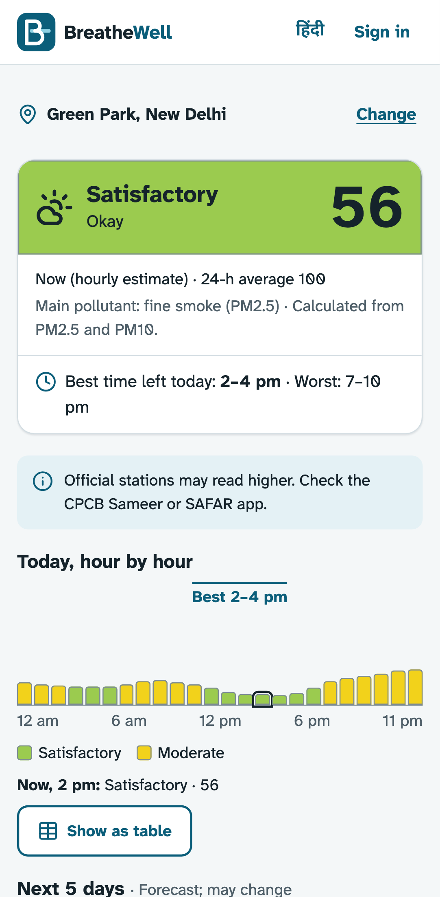
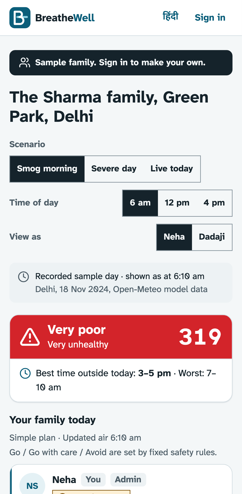
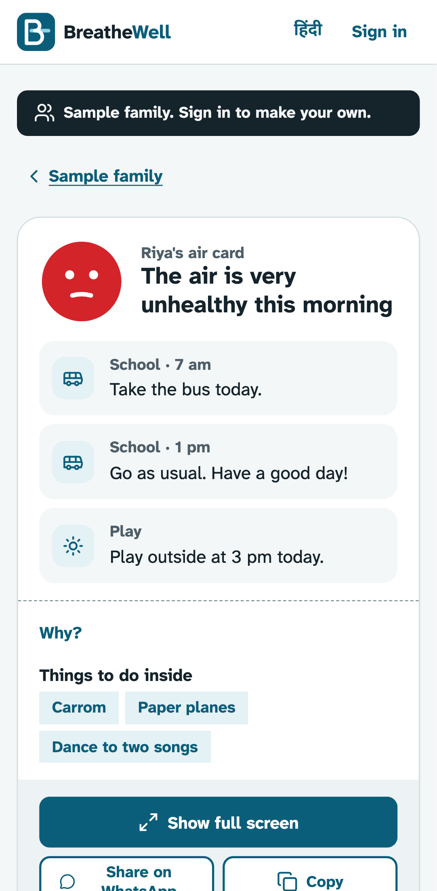
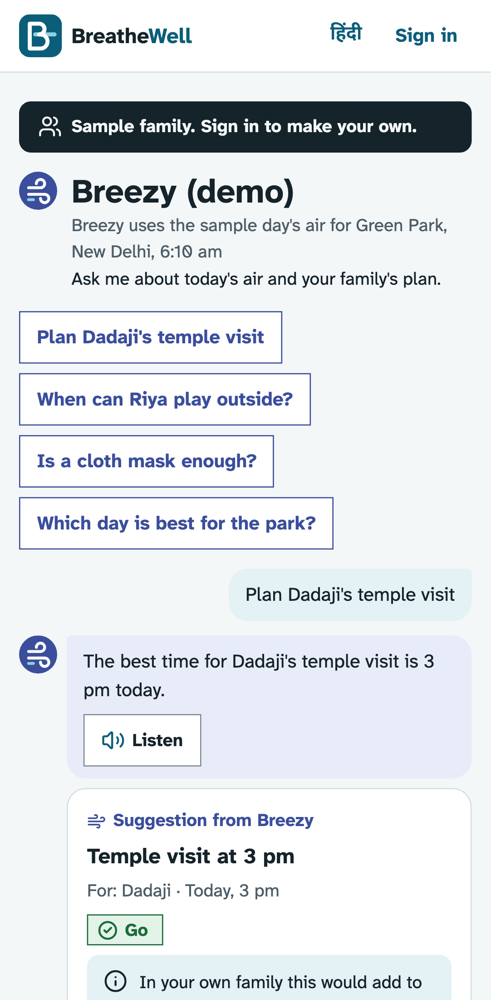

# BreatheWell

[](https://github.com/Dhruvk2004/BreatheWell/actions/workflows/ci.yml)

**Know when your family can breathe easy.** BreatheWell is a family air coach for winter smog in Indian cities. It reads the air where you live, hour by hour, and tells each person, in English or Hindi, whether to go out today, the best time to go, and one simple change that helps them and the air.

**Live app:** [breathe-well-theta.vercel.app](https://breathe-well-theta.vercel.app/) · Try **Air now** and the **demo family** with no sign-in.

<p>
  
  
  
  
</p>

## Features

- **Air now** for any Indian city: today's air on India's CPCB scale, the next 24 hours, a 5-day outlook, home tips and one low-smoke swap.
- **A plan for every family member**: Go, Go with care or Avoid, the best time to step out, and why it matters, in words a grandparent or a child understands.
- **Family accounts**: adults join with a code or QR. Children are added by a parent and get a simple kid card to show or share on WhatsApp.
- **Breezy**, an air assistant that answers questions and adds reminders to a family member's checklist.
- **A community message** for your housing society or school group, in English and Hindi, ready to share.
- **Built for everyone**: English and Hindi, phone-first screens, and a saved plan when you're offline.

## How it works

Tested rules decide every verdict, time and number. Google Gemini only puts them into friendly words, and its text is checked before it is shown. Names and health details are never sent to the AI.

| The challenge asks for | BreatheWell |
|---|---|
| A GenAI assistant for families and communities | Gemini writes each person's plan, Breezy's answers and a daily message for a housing society or school group |
| Severe winter smog and urban pollution | Hourly PM2.5, PM10, NO₂, O₃, CO and SO₂ on India's CPCB scale, with a Severe-day mode |
| Low-emission daily routines | Walks, play and errands moved to the cleanest hours; car trips swapped for metro, bus or carpool |
| Indoor air quality hacks | Home tips from your home set-up: purifier, road-facing windows, cooking fuel, incense |
| Sustainable alternatives, tailored to location and lifestyle | Each adult's own routine, travel and health; the place from location or search |
| Clearly explaining the direct impact | "Do this · Picture it · The numbers": exposure saved, CO₂ and PM avoided, a weekly family total |

The full mapping, down to the code, is in [docs/judges.md](docs/judges.md#brief-to-feature).

## Security

- Google sign-in (adults only) with an httpOnly session cookie checked on the server. Every write goes through an API route that validates the body with Zod, checks the family role and the request's origin.
- Firestore rules deny by default and are tested role by role on the emulator. Health details are stored apart and never sent to Gemini; Gemini's output is schema-checked and screened before it is shown.
- Rate limits, a body size cap, a strict Content-Security-Policy, `X-Frame-Options: DENY`, HSTS and no secrets in browser code. CI runs with read-only permissions and pinned actions; Dependabot proposes updates weekly. See [SECURITY.md](SECURITY.md).

## Testing

- **About 2,600 Vitest unit and component tests**, with 95% coverage thresholds enforced (currently about 99.6% of lines). Every rule is a pure function with an injected clock, so tests can pin any hour of any day.
- **317 Firestore emulator tests**: the security-rule matrix (every role against every path), the plan lock, the air cache and the daily clean-up.
- **100 Playwright browser tests** with axe: 72 public tests on phone and desktop in English and Hindi, and 28 signed-in journeys on the Firebase Auth emulator (join by QR, add a child, tick a plan, delete an account).
- All of it runs in [CI](.github/workflows/ci.yml) on every push.

## Accessibility

- WCAG 2.2 AA is the target. axe runs on every public page in both languages and on the signed-in pages, with zero violations; ESLint runs the strict `jsx-a11y` rule set.
- Every air band and verdict has a colour, a word and an icon, never colour alone. Skip link, landmarks, one `h1` per page, labelled controls, visible focus and 44 px touch targets.
- Sizes are in `rem`, so the phone's own text size scales everything. Hindi pages are served with `lang="hi"`; motion respects `prefers-reduced-motion`. Kid cards use words and clock times, no numbers.

## Performance

- Public pages are prerendered in English and Hindi and served from the CDN; the public air APIs are cached at the edge for 10 minutes.
- Air data is fetched once per area and hour and shared by every visitor in that area. Gemini runs with thinking off and a JSON schema, one call per family plan and one community message per area per day.
- Heavy code loads only when needed: the Firebase sign-in SDK on sign-in, and the city search and validation code on first use.

## Built with

Next.js, React, TypeScript and Tailwind · Firebase Auth and Firestore · Google Gemini · Open-Meteo air data · Vitest, Playwright and axe. Hosted for free on Vercel and Firebase.

## Run it locally

Needs Node 22 or later. With no settings, the public pages and the demo work out of the box.

```bash
npm ci
npm run dev
```

To use sign-in and Gemini, copy `.env.example` to `.env.local` and fill it in (a free Firebase project and a free Gemini key from Google AI Studio). Tests: `npm run check` and `npm run test:e2e`.

## More

- [Notes for judges](docs/judges.md): the challenge brief mapped to features and code, the architecture and security notes.
- Security reports: see [SECURITY.md](SECURITY.md). Questions or data requests: open an issue in this repository. You can also delete your own data any time from Profile → Delete my account.

## Licence

MIT
